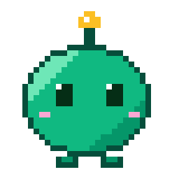

<p align="center">
  
</p>

<h1 align="center">DeskPixie</h1>

<p align="center">
  <a href="LICENSE"></a>
  <a href="https://github.com/sihekuang/deskpixie/releases/latest"></a>
</p>

**DeskPixie is a voice layer on top of your coding agents**, for macOS. You talk with **Pixie**, a
small character on your desktop, and Pixie hands real work to **the coordinator**, a Claude Code
agent (or OpenAI Codex: Settings ▸ Coordinator ▸ Coordinator agent) working in the background. It
also keeps you in touch with the Claude Code and Codex sessions you start yourself: their news,
their questions and their windows, by voice.

Under the hood: a Go core (`core/`, built as the C-ABI dylib `libdeskpixie`) hosted by a Swift
macOS app (`mac/`).

## What it does

- **Talk to Pixie.** Pixie listens and answers through Gemini Live or OpenAI Realtime, with your
  own API key. It does quick things itself: the time, the weather, timers, arithmetic, music.
- **Hand off real work.** Everything else goes to the coordinator, which runs in a
  [Herdr](https://herdr.dev) (or tmux) session and can start worker agents in git worktrees of
  your projects. Results, questions and permission requests come back by voice.
- **Or type instead.** Flip the 🔊/💬 toggle under Pixie to text mode: type a quick message
  straight to the coordinator and read its short answer, without a sound. Stop it any time.
- **Watch the agents you start yourself.** Run `pix claude` or `pix codex` in any terminal, and
  Pixie can see, message and interrupt those sessions, pass on their questions, and bring one to
  the front ("show me the deskpixie session").
- **Show, not just tell.** The coordinator can open canvas pages (charts, diagrams, comparisons)
  next to Pixie.
- **Make your own pixie.** Draw a sprite sheet, put it in your pixies folder, and pick it in
  Settings. See [docs/making-a-pixie.md](docs/making-a-pixie.md).

## Requirements

- macOS 14 or later, Apple silicon.
- A Gemini or OpenAI API key for the voice.
- For handing off work: [Claude Code](https://docs.anthropic.com/en/docs/claude-code) or
  [Codex](https://github.com/openai/codex), and [Herdr](https://herdr.dev) (or tmux).

## Install

Download the `.dmg` from [Releases](https://github.com/sihekuang/deskpixie/releases/latest), open
it and drag DeskPixie to `/Applications`. Releases are signed with a Developer ID and notarized
by Apple. DeskPixie lives in the menu bar and asks for microphone access the first time you talk.

## First run

On a new Mac, DeskPixie opens a welcome window: pick your Pixie, pick what it does (talk, run agents, watch your
own sessions, show canvas pages) and set each part up (voice key and microphone, herdr and Claude
Code or Codex, the `pix` command), then allow every macOS permission at once so none interrupts you
later. Every choice is the same setting as in Settings. Open it again
from the menu bar: Welcome to DeskPixie…. See `docs/superpowers/specs/2026-10-17-onboarding-design.md`.

## Sessions you start yourself

Start Claude Code or Codex with `pix` (`pix claude`, `pix codex`) in any terminal — WebStorm,
iTerm, VS Code — and Pixie can see, message and interrupt it next to its own workers. Quitting
DeskPixie never ends those sessions. Install the command from Settings ▸ Sessions ▸ pix
command. See [docs/pix.md](docs/pix.md).

## Supported Herdr versions

Delegation runs the coordinator (Claude Code) in a [Herdr](https://herdr.dev) session. DeskPixie supports
**Herdr 0.7.5 (protocol 17) or 0.9.x (protocol 22)** (`compat.SupportedVersions` in
`core/herdr/compat`). The `herdr` program and the session's running server must be the same
version; otherwise the tray shows "Coordinator: herdr version mismatch: …" with the version you have.
After updating herdr, restart DeskPixie's session (`herdr session stop deskpixie`, which closes
its panes) so a new server starts. Herdr also warns when its Claude Code hook is outdated:
`herdr integration status` should say `claude: current`; DeskPixie never installs it for you.

## Build from source

You need Xcode, [XcodeGen](https://github.com/yonaskolb/XcodeGen) and Go 1.26 or later.

```sh
make -C mac build         # the app (Debug), with the Go core built and bundled
make -C mac run           # launch the built app
make -C mac test          # Swift tests
(cd core && go test ./...)  # Go tests
```

A plain `make -C mac build` is ad-hoc signed, so macOS asks for the microphone again after every
rebuild; `SIGNING_IDENTITY="Developer ID Application: …"` keeps the permission. Release builds:
`make -C mac release VERSION=x.y.z` (see [docs/release.md](docs/release.md)). Tests against real
services (voice providers, Claude Code, Herdr) are opt-in with `-tags live`.

## Project layout

| Path | What's there |
|---|---|
| `core/` | The Go core: voice providers and conversation (`voice/`), the coordinator and workers (`agent/`), Herdr and tmux hosts, the `pix` command (`pix/`, `cmd/pix`), Pixie's own tools, audio. |
| `mac/` | The Swift macOS app: Pixie's window, the menu bar, Settings, onboarding, audio I/O. |
| `design-system/` | The canvas pages' styles, scripts and examples. |
| `pixies/` | Pixie's character sprite sheets. To make your own, see [docs/making-a-pixie.md](docs/making-a-pixie.md). |
| `docs/` | Specs, plans and decisions (`docs/decisions.md`). |

This repo is the port of ai-mascot (Rust/Tauri). See `docs/specs/2026-10-13-deskpixie-port-design.md`.

## Roadmap

- **More coding agents.** DeskPixie works with Claude Code and OpenAI Codex today; support for
  other coding agents is coming.
- **More platforms.** DeskPixie runs on macOS today; support for other platforms, such as Windows
  and Linux, is planned.

Ideas and requests are welcome as [issues](https://github.com/sihekuang/deskpixie/issues).

## Contributing

Issues and pull requests are welcome. Please open an issue first for anything large. [AGENTS.md](AGENTS.md) describes how changes are made and tested here. Unless you
say otherwise, contributions are licensed under the Apache License 2.0, as section 5 of the
license says.

## License

DeskPixie is licensed under the [Apache License 2.0](LICENSE). Copyright 2026 Daniel Lee; see
[NOTICE](NOTICE).

The license doesn't grant rights to use the DeskPixie name or marks (section 6). DeskPixie bundles
third-party components under their own licenses; see
[THIRD-PARTY-NOTICES.md](THIRD-PARTY-NOTICES.md).
